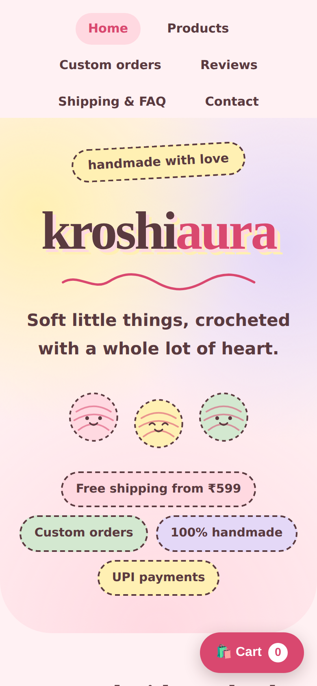
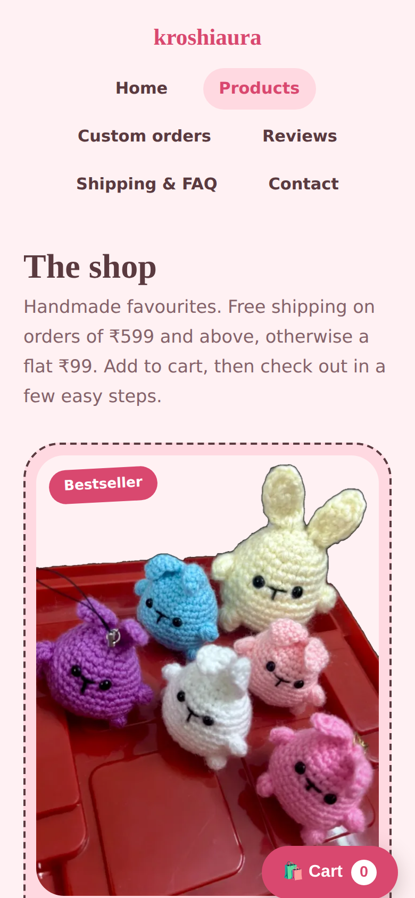
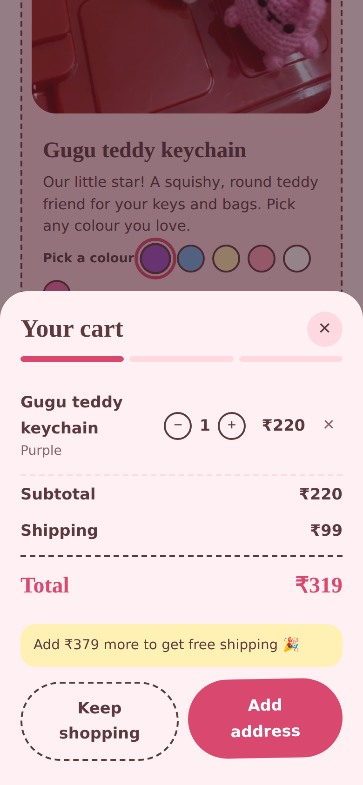
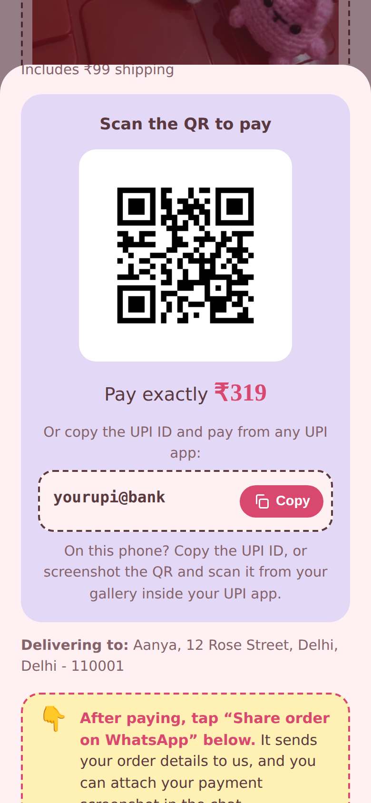

# kroshiaura: handmade crochet shop

A mobile-first online store for a small handmade crochet brand in India. Customers browse products, build a cart, enter delivery details and pay by UPI. The order is saved to a Google Sheet and shared with the seller on WhatsApp.

**Live site:** https://kroshiaura.netlify.app

| Home | Products | Cart | Payment |
|---|---|---|---|
|  |  |  |  |

> The screenshots come from a demo build with placeholder contact details. Fonts may look slightly different from the live site.

## Features
- Single-page site with six pages (Home, Products, Custom orders, Reviews, Shipping & FAQ, Contact) using hash-based routing
- Product cards with colour swatches, a cart with quantity controls and persistent cart storage
- Shipping rule built into the cart: free from ₹599, otherwise a flat ₹99
- Checkout with validated delivery details (phone, 6-digit pincode)
- UPI payment screen with the exact amount, a QR code and a copy button
- One-tap order sharing to WhatsApp with a pre-filled message
- Custom-order form with reference photo upload (resized in the browser before sending)
- Orders, custom requests and approved reviews stored in Google Sheets
- Responsive, accessible (keyboard focus, labels, reduced-motion support) and light/dark theme aware

## Tech stack
- **Frontend:** HTML, CSS and vanilla JavaScript in one file, with no frameworks or build step
- **Backend:** Google Apps Script web app writing to Google Sheets and Google Drive
- **Hosting:** Netlify, deployed from GitHub
- **Design:** custom palette, stitched-edge visual language, hand-built SVG illustrations

## How it works
```
Customer phone  ->  index.html (Netlify)
                      |-- order / custom request / review  -> Apps Script -> Google Sheet (+ Drive for photos)
                      |-- Share on WhatsApp                -> wa.me link with order details
                      '-- Pay by UPI                       -> QR code / UPI ID shown on screen
```

## Challenges and what I learned
- UPI apps blocked payment links with a preset amount sent to a personal UPI ID ("payment mode not allowed"). I replaced app deep links with a QR code plus a copyable UPI ID, and documented merchant UPI accounts and payment gateways as the next step.
- Apps Script web apps can't be called with normal CORS requests from another site, so the order is sent as a fire-and-forget request and the backend logs its own errors and has a status endpoint for debugging.
- Keeping personal data out of a public repository: this repo uses placeholders for the UPI ID, phone number and backend URL.

## Run it yourself
1. Follow `SETUP.md` to create the Google Sheet backend and deploy `Code.gs`.
2. In `index.html`, set `UPI_ID`, `SCRIPT_URL` and the WhatsApp number.
3. Host `index.html` on Netlify, GitHub Pages or any static host.

## Credits
Designed and built by the shop owner with AI assistance (Claude by Anthropic) for code and design iteration.
